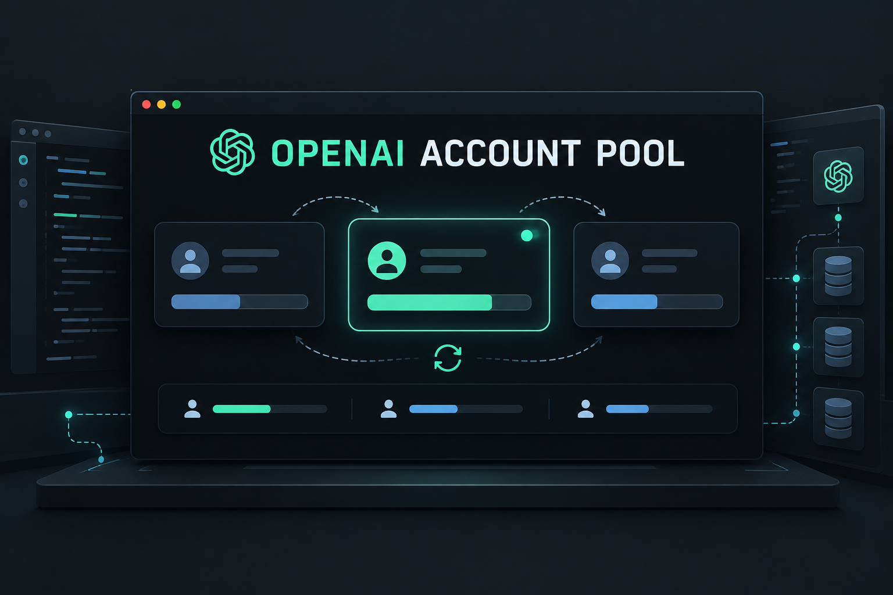

# omp OpenAI Account Pool
<p align="center">
    
</p>

An `omp` extension for managing multiple OpenAI Codex OAuth accounts in one profile.

## Features

- Shows a compact one-line account and quota widget above the editor.
- Displays remaining quota, reset times, and usage freshness.
- Warns when the active account falls below a configurable quota threshold.
- Rotates to another account when the active account reaches a limit.
- Optionally switches early when remaining quota falls below a configured threshold.
- Provides an account picker, health checks, usage history, and account labels.
- Never stores or displays access or refresh tokens.

This plugin targets `openai-codex` ChatGPT OAuth accounts. It does not manage `OPENAI_API_KEY` credentials for the separate `openai` API provider.

## Requirements

- Global `omp` 18.11.1 or newer.
- Two or more OpenAI Codex OAuth accounts:

```text
/login openai-codex
/login openai-codex
```

## Install

From this directory:

```sh
omp plugin link .
```

Or load it for one session:

```sh
omp --extension ./src/index.ts
```

Restart `omp` after installing or changing the plugin.

The global `omp` binary is the runtime. `@oh-my-pi/pi-ai` and `@oh-my-pi/pi-coding-agent` are development-only dependencies for TypeScript types and editor support; they do not install another runtime or load at runtime.

## Commands

| Command | Description |
| --- | --- |
| `/openai-accounts` | Open the account menu. |

## TUI menu

Run `/openai-accounts` to open the account menu. It provides account selection, usage refresh, health check, history, automatic routing, and status widget toggle.

Example widget:

```text
OpenAI: Personal | 5h 72% (reset 2h) / 7d 88% (reset 4d) | updated 12s
```

Quota values are snapshots returned by OpenAI's usage endpoint. The plugin does not estimate usage from token counts.

## Configuration

Usage refresh defaults to once per 60 seconds:

```sh
OMP_OPENAI_ACCOUNT_REFRESH_SECONDS=30
OMP_OPENAI_ACCOUNT_AUTO_SWITCH=0
OMP_OPENAI_ACCOUNT_STATUS=1
OMP_OPENAI_ACCOUNT_WARNING_PERCENT=20
OMP_OPENAI_ACCOUNT_MIN_REMAINING_PERCENT=0
OMP_OPENAI_ACCOUNT_LABELS="personal@example.com=Personal,work@example.com=Work"
```

`OMP_OPENAI_ACCOUNT_AUTO_SWITCH=0` disables automatic rotation by the plugin. Core `omp` retry and account rotation behavior remains enabled.

`OMP_OPENAI_ACCOUNT_STATUS=0` disables the widget at startup. Use the TUI menu to toggle it during the current session.

`OMP_OPENAI_ACCOUNT_MIN_REMAINING_PERCENT` is disabled at `0`. Set it to a positive value to switch before the active account is exhausted.

## Security and limitations

- Extensions run with the same permissions as `omp`; install only trusted source.
- Credentials remain in `omp`'s credential store and are not printed by the plugin.
- If usage data cannot be matched to an account, the plugin shows `usage unavailable` instead of guessing.
- If every account is exhausted, the plugin cannot create additional quota; reset and retry behavior remains controlled by `omp` and OpenAI.
